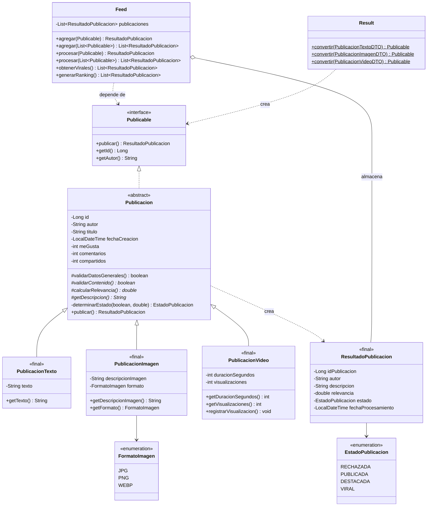
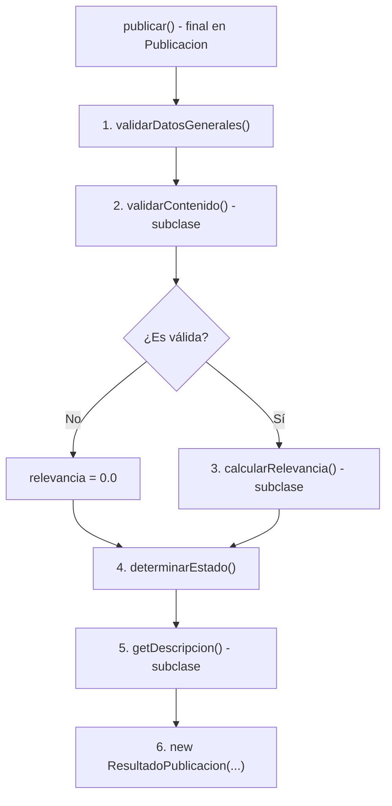

# Práctica #11 · Polimorfismo (2da parte)

## Vibe – Sistema de publicaciones para una red social

| | |
|---|---|
| **Alumno** | Ludwin Cadmiel Salinas Luciano |
| **Materia** | Modelos de Programación Orientada a Objetos |
| **Práctica** | #11 – Polimorfismo (Parte 2) |
| **HackerRank** | https://www.hackerrank.com/mpoo-2027-1-practica11 |

---

## Contenido

1. [Descripción del problema](#1-descripción-del-problema)
2. [Archivos de la práctica](#2-archivos-de-la-práctica)
3. [Diagrama de clases](#3-diagrama-de-clases)
4. [Explicación de la solución y decisiones de diseño](#4-explicación-de-la-solución-y-decisiones-de-diseño)
5. [Evidencias de ejecución](#5-evidencias-de-ejecución)
6. [Preguntas de reflexión](#6-preguntas-de-reflexión)
7. [Conclusiones](#7-conclusiones)
8. [Trazabilidad y reproducibilidad](#8-trazabilidad-y-reproducibilidad)

---

## 1. Descripción del problema

Vibe permite compartir publicaciones de **texto**, **imagen** y **video**. Todas tienen información común (id, autor, título, fecha de creación, me gusta, comentarios y compartidos), pero cada tipo **valida su contenido** y **calcula su relevancia** de forma distinta.

El sistema debe:

- Trabajar con todas las publicaciones mediante el contrato común `Publicable`.
- Usar el patrón **Template Method** para definir una sola vez el proceso de publicación.
- Clasificar cada publicación como `RECHAZADA`, `PUBLICADA`, `DESTACADA` o `VIRAL`.
- Procesar una publicación individual o una colección, generar un ranking y obtener las virales.
- **No** usar `instanceof`, `if` ni `switch` para decidir cómo validar o calcular cada tipo: eso se resuelve con polimorfismo.

### Reglas de negocio

| Tipo | Validación del contenido | Relevancia | Descripción |
|---|---|---|---|
| Texto | 10 ≤ longitud de `texto.trim()` ≤ 280 | `meGusta + comentarios·3 + compartidos·5` | `Texto \| <titulo> \| <autor>` |
| Imagen | Descripción no vacía y `formato != null` | `meGusta·2 + comentarios·3 + compartidos·5` | `Imagen \| <titulo> \| <formato> \| <autor>` |
| Video | 0 < duración ≤ 600 y visualizaciones ≥ 0 | `meGusta·2 + comentarios·4 + compartidos·6 + visualizaciones/100.0` | `Video \| <titulo> \| <duracion> s \| <autor>` |

**Datos generales** (todas las publicaciones): `id != null && id > 0`, autor y título no nulos ni vacíos, contadores ≥ 0.

| Condición | Estado |
|---|---|
| Datos generales o contenido inválidos | `RECHAZADA` (relevancia `0.00`) |
| Relevancia 0 – 99 | `PUBLICADA` |
| Relevancia 100 – 299 | `DESTACADA` |
| Relevancia ≥ 300 | `VIRAL` |

---

## 2. Archivos de la práctica

```
Práctica 11/
├── Practica11.java        ← Solución completa (misma que se envió a HackerRank)
├── README.md              ← Este reporte
├── .gitignore             ← Ignora *.class y carpetas del IDE
└── evidencias/
    ├── entrada.txt        ← Caso de prueba propio (9 publicaciones)
    └── salida.txt         ← Salida obtenida al ejecutar Practica11 con entrada.txt
```

> **Nota:** En HackerRank la clase principal se llama `Solution`. En GitHub se renombró a `Practica11` (igual que en las prácticas anteriores) para que el nombre del archivo coincida con la clase pública. **Es el único cambio**: interfaces, firmas, enums y DTO proporcionados se conservan exactamente igual.

### Clases que contiene `Practica11.java`

| Clase / tipo | Rol |
|---|---|
| `Publicable` | Interfaz (contrato común). **Abstracción**. |
| `Publicacion` | Clase abstracta: estado común + **método plantilla** `publicar()`. |
| `PublicacionTexto`, `PublicacionImagen`, `PublicacionVideo` | Tipos concretos (`final`). Implementan los pasos variables. |
| `FormatoImagen`, `EstadoPublicacion` | Enums proporcionados. |
| `ResultadoPublicacion` | Resultado **inmutable** del procesamiento. |
| `Feed` | Servicio que procesa publicaciones, genera ranking y virales. Solo conoce `Publicable`. |
| `PublicacionDTO` y subclases | DTO proporcionados por HackerRank (sin modificar). |
| `Result` | Adaptador DTO → dominio (convierte el `String` del formato a `FormatoImagen`). |
| `HackerRankVibe`, `Practica11` | Lectura de entrada / impresión (código proporcionado). |

---

## 3. Diagrama de clases



### Flujo del método plantilla `publicar()`



---

## 4. Explicación de la solución y decisiones de diseño

### 4.1 Template Method en `Publicacion`

`Publicacion.publicar()` está declarado como **`public final`**, de modo que las subclases **no pueden sobrescribirlo** y el orden de los 6 pasos queda fijo:

```java
@Override
public final ResultadoPublicacion publicar() {
    boolean datosValidos = validarDatosGenerales();                    // 1
    boolean esValida = datosValidos && validarContenido();             // 2
    double relevancia = esValida ? calcularRelevancia() : 0.0;         // 3
    EstadoPublicacion estado = determinarEstado(esValida, relevancia); // 4
    String descripcion = getDescripcion();                             // 5
    return new ResultadoPublicacion(id, autor, descripcion,
            relevancia, estado, LocalDateTime.now());                  // 6
}
```

- Los pasos **comunes** (1 y 4) están implementados una sola vez en la clase base, sin duplicar código en las subclases.
- Los pasos **variables** (`validarContenido`, `calcularRelevancia`, `getDescripcion`) son `protected abstract`: cada subclase está obligada a implementarlos y no forman parte de la API pública.
- `calcularRelevancia()` solo se invoca si la publicación es válida (cortocircuito), así una publicación inválida siempre queda en `0.0` / `RECHAZADA`.
- Los umbrales `100` y `300` son constantes (`UMBRAL_DESTACADA`, `UMBRAL_VIRAL`) en lugar de números mágicos.

### 4.2 Polimorfismo sin `instanceof`, `if` ni `switch` sobre tipos

`Feed` recibe `Publicable` y solo invoca `publicacion.publicar()`. Java decide **en tiempo de ejecución** (enlace dinámico) qué `validarContenido()`, `calcularRelevancia()` y `getDescripcion()` ejecutar. Los únicos `if` del dominio validan **datos** (nulos, rangos, umbrales), nunca el **tipo** de la publicación.

> El `switch` que existe en `HackerRankVibe.convertirEntrada()` pertenece al código proporcionado por HackerRank: decide qué DTO construir a partir del texto de entrada (parseo), no cómo se comporta una publicación.

### 4.3 Encapsulamiento e inmutabilidad

- Todos los atributos son `private`; los de `Publicacion` y `ResultadoPublicacion` además son `final`.
- `fechaCreacion` se asigna en el constructor con `LocalDateTime.now()`; no puede modificarse después.
- `ResultadoPublicacion` es una clase `final`, sin setters: un resultado ya calculado no puede alterarse.
- Las subclases acceden a los contadores mediante los getters heredados, no a los atributos.
- `PublicacionVideo.visualizaciones` es el único atributo mutable y solo cambia mediante el **método de comportamiento** `registrarVisualizacion()` (no existe `setVisualizaciones`).
- `Feed.getPublicaciones()`, `obtenerVirales()` y `generarRanking()` devuelven **listas nuevas** (copias defensivas), por lo que nadie externo puede alterar la lista interna del Feed.
- Las subclases son `final`: nadie puede extender `PublicacionTexto` y cambiar sus reglas.

### 4.4 Las operaciones inválidas conservan el estado válido

- Una publicación con datos inválidos **no lanza excepción**: produce un `ResultadoPublicacion` con estado `RECHAZADA`, sin afectar a las demás.
- `Feed.agregar(null)` lanza `IllegalArgumentException` **antes** de modificar la lista.
- `Feed.agregar(List)` primero verifica que la colección no sea nula y que **no contenga elementos nulos**; solo entonces procesa. Así, una colección inválida no deja el Feed a medio llenar (operación de todo o nada).
- En `Result.convertir(PublicacionImagenDTO)`, un formato desconocido (p. ej. `GIF`) se convierte en `null` en lugar de romper el programa; la publicación queda `RECHAZADA` por su propia validación.

### 4.5 `Feed`: reutilización y ranking estable

- `agregar(List)` **reutiliza** `agregar(Publicable)`; `procesar(...)` delega en `agregar(...)` (sobrecarga de métodos).
- `generarRanking()` usa `Comparator.comparingDouble(ResultadoPublicacion::getRelevancia).reversed()`. `List.sort` es un algoritmo **estable** (TimSort), por lo que ante empates aparece primero la publicación procesada anteriormente, como pide el enunciado (ver ids 1 y 7 en la evidencia).

### 4.6 Principio de Inversión de Dependencias (DIP) y Ley de Demeter

- `Feed` (módulo de alto nivel) depende de la **abstracción** `Publicable`, no de las clases concretas. Agregar un nuevo tipo (p. ej. `PublicacionEncuesta`) no requiere modificar `Feed` (también cumple **Abierto/Cerrado**).
- `Feed` solo habla con sus "amigos inmediatos": llama a `publicar()` y lee el `ResultadoPublicacion` que él mismo almacena. Nunca hace cadenas como `publicacion.getX().getY()` ni consulta los contadores internos.

### 4.7 Adaptador `Result`

Los DTO de HackerRank traen el formato de imagen como `String`. `Result` traduce cada DTO al objeto de dominio correspondiente y convierte el `String` en `FormatoImagen`, separando la capa de entrada del modelo de negocio. Los métodos `convertir(...)` están **sobrecargados** por tipo de DTO, de modo que el compilador elige el adecuado sin `if`.

---

## 5. Evidencias de ejecución

### 5.1 HackerRank

> 📸 Las capturas de los casos de prueba aprobados en HackerRank se agregan en la carpeta [`evidencias/`](evidencias/).

### 5.2 Caso de prueba propio

Diseñé un caso que cubre **todos los estados**, los **dos ejemplos del enunciado**, **entradas inválidas** de cada tipo y un **empate** en el ranking.

**Entrada** ([`evidencias/entrada.txt`](evidencias/entrada.txt)):

```
9
TEXTO|1|ana|Hola Vibe|100|20|10|Mi primera publicacion en Vibe
IMAGEN|2|luis|Atardecer|100|20|10|Foto del atardecer en la playa|png
VIDEO|3|sofia|Tutorial Java|50|10|5|300|2500
TEXTO|4|pedro|Corto|10|1|1|Hola
IMAGEN|5|maria|Selfie|5|1|0|Foto de perfil|GIF
VIDEO|6|carlos|Video largo|10|0|0|900|0
TEXTO|7|lucia|Empate|150|10|6|Este texto empata con la publicacion 1
VIDEO|8|diego|Clip viral|100|30|20|120|10000
TEXTO|9|eva|Sin interacciones|0|0|0|Publicacion valida sin interacciones
```

**Salida obtenida** ([`evidencias/salida.txt`](evidencias/salida.txt)):

```
1|Texto | Hola Vibe | ana|210.00|DESTACADA
2|Imagen | Atardecer | PNG | luis|310.00|VIRAL
3|Video | Tutorial Java | 300 s | sofia|195.00|DESTACADA
4|Texto | Corto | pedro|0.00|RECHAZADA
5|Imagen | Selfie | null | maria|0.00|RECHAZADA
6|Video | Video largo | 900 s | carlos|0.00|RECHAZADA
7|Texto | Empate | lucia|210.00|DESTACADA
8|Video | Clip viral | 120 s | diego|540.00|VIRAL
9|Texto | Sin interacciones | eva|0.00|PUBLICADA
RANKING
8|540.00|VIRAL
2|310.00|VIRAL
1|210.00|DESTACADA
7|210.00|DESTACADA
3|195.00|DESTACADA
4|0.00|RECHAZADA
5|0.00|RECHAZADA
6|0.00|RECHAZADA
9|0.00|PUBLICADA
VIRALES
2|Imagen | Atardecer | PNG | luis|310.00
8|Video | Clip viral | 120 s | diego|540.00
```

### 5.3 Verificación manual de los resultados

| Id | Qué prueba | Cálculo | Esperado | Obtenido |
|---|---|---|---|---|
| 1 | Ejemplo del enunciado (texto) | 100 + 20·3 + 10·5 = **210** | DESTACADA | ✅ |
| 2 | Ejemplo del enunciado (imagen), formato en minúsculas | 100·2 + 20·3 + 10·5 = **310** | VIRAL | ✅ |
| 3 | Video con visualizaciones | 50·2 + 10·4 + 5·6 + 2500/100 = **195** | DESTACADA | ✅ |
| 4 | Texto de 4 caracteres (< 10) | inválido → 0 | RECHAZADA | ✅ |
| 5 | Formato `GIF` no permitido → `formato = null` | inválido → 0 | RECHAZADA | ✅ |
| 6 | Video de 900 s (> 600) | inválido → 0 | RECHAZADA | ✅ |
| 7 | Empate con id 1 | 150 + 10·3 + 6·5 = **210** | DESTACADA, después de 1 en ranking | ✅ |
| 8 | Video viral | 100·2 + 30·4 + 20·6 + 10000/100 = **540** | VIRAL | ✅ |
| 9 | Válida con 0 interacciones (límite inferior) | 0 | PUBLICADA | ✅ |

El **ranking** va de mayor a menor relevancia; en los empates (1 y 7 con 210; 4, 5, 6 y 9 con 0) se respeta el orden de procesamiento. **VIRALES** contiene solo las publicaciones con estado `VIRAL`, en orden de procesamiento.

---

## 6. Preguntas de reflexión

### 1. ¿En qué lugares se está aplicando el polimorfismo?

1. **Polimorfismo de subtipo (por inclusión):** `List<Publicable>` almacena a la vez `PublicacionTexto`, `PublicacionImagen` y `PublicacionVideo`. `Feed.agregar(Publicable)` recibe cualquiera de ellas a través de la misma referencia.
2. **Sobrescritura y enlace dinámico:** dentro de `publicar()`, las llamadas a `validarContenido()`, `calcularRelevancia()` y `getDescripcion()` se resuelven en tiempo de ejecución según el objeto real. El mismo código de `Publicacion` produce `Texto | ...` o `Video | ... s | ...` sin saber de qué tipo es.
3. **Implementación de interfaz:** `Publicacion` implementa `publicar()`, `getId()` y `getAutor()` del contrato `Publicable`, y `Feed` los invoca sin conocer la clase concreta.
4. **Sobrecarga (polimorfismo estático, en compilación):** `Feed.agregar(Publicable)` / `agregar(List<Publicable>)`, `procesar(...)` y `Result.convertir(PublicacionTextoDTO | PublicacionImagenDTO | PublicacionVideoDTO)`. El compilador elige el método según el tipo del argumento.
5. **Herencia en los DTO:** `PublicacionTextoDTO`, `PublicacionImagenDTO` y `PublicacionVideoDTO` son subtipos de `PublicacionDTO` y heredan sus getters.
6. **`toString()`** sobrescrito en `ResultadoPublicacion` (sobrescritura de un método de `Object`).

Gracias a esto, en `Feed` no existe ningún `instanceof`, `if` ni `switch` sobre el tipo de publicación.

### 2. Declaración de `Publicacion` como clase sellada (`sealed`)

Las clases selladas (Java 17, JEP 409) permiten que una clase o interfaz indique **explícitamente qué clases pueden extenderla**. Así la jerarquía de Vibe quedaría cerrada a solo tres tipos:

```java
public abstract sealed class Publicacion implements Publicable
        permits PublicacionTexto, PublicacionImagen, PublicacionVideo {
    // ... mismo código ...
}

public final class PublicacionTexto  extends Publicacion { /* ... */ }
public final class PublicacionImagen extends Publicacion { /* ... */ }
public final class PublicacionVideo  extends Publicacion { /* ... */ }
```

Requisitos: cada subclase permitida debe declararse `final`, `sealed` o `non-sealed`, y debe estar en el mismo módulo (o en el mismo paquete si no se usan módulos). En mi solución las subclases ya son `final`, por lo que solo faltaría agregar `sealed ... permits ...` a `Publicacion`. Con esto, si alguien intenta escribir `class PublicacionAudio extends Publicacion`, obtiene un **error de compilación**.

### 3. Diferencia entre `final`, `sealed` y `non-sealed`

| Modificador | Qué permite | Efecto en Vibe | Cuándo lo usaría |
|---|---|---|---|
| `final` | **Nadie** puede extender la clase. | `PublicacionTexto` (así está en mi código): nadie puede crear `PublicacionTextoLarga` y cambiar las reglas de validación o la fórmula. | Clases hoja o de valor que no deben cambiar: `ResultadoPublicacion`, `String`, los tipos concretos de publicación. |
| `sealed` | Solo las clases listadas en `permits` pueden extenderla. | `Publicacion` aceptaría únicamente Texto, Imagen y Video. La jerarquía es conocida y cerrada. | Cuando el dominio tiene un número fijo de variantes y quiero controlarlas (formas: Círculo/Cuadrado, tipos de pago aceptados). |
| `non-sealed` | Una subclase de una clase sellada vuelve a quedar **abierta** a cualquiera. | Si declarara `non-sealed class PublicacionVideo`, se podrían crear `VideoEnVivo` o `Reel` extendiendo `PublicacionVideo`, aunque `Publicacion` siga sellada. | Cuando una rama concreta necesita extensibilidad (p. ej. que otros equipos agreguen formatos de video) sin abrir toda la jerarquía. |

Resumen: `final` cierra totalmente, `sealed` abre de forma controlada y `non-sealed` vuelve a abrir una rama de una jerarquía sellada.

### 4. Principio de Inversión de Dependencias (DIP)

El DIP dice: *"Los módulos de alto nivel no deben depender de módulos de bajo nivel; ambos deben depender de abstracciones. Las abstracciones no deben depender de los detalles; los detalles deben depender de las abstracciones."*

- **Abstracciones:** `Publicable` (contrato) y, en segundo nivel, `Publicacion` (clase abstracta que fija el algoritmo).
- **Detalles concretos:** `PublicacionTexto`, `PublicacionImagen` y `PublicacionVideo`.
- **Módulo de alto nivel:** `Feed`.

**¿Por qué es preferible?** Si `Feed` dependiera de las clases concretas necesitaría métodos como `agregarTexto(...)`, `agregarImagen(...)` y `agregarVideo(...)`, o un `if (p instanceof PublicacionVideo)` para cada caso. Cada vez que Vibe agregara un tipo nuevo (audio, encuesta, historia) habría que **modificar y volver a probar `Feed`**, violando el principio Abierto/Cerrado. Al depender de `Publicable`:

- Se agrega un tipo nuevo creando una clase y `Feed` funciona sin cambios.
- `Feed` se puede probar con cualquier implementación (incluso una publicación falsa para pruebas).
- El acoplamiento es mínimo: un cambio en la fórmula del video no afecta al Feed.

### 5. Ley de Demeter (Principio del Mínimo Conocimiento)

La Ley de Demeter dice que un objeto solo debe comunicarse con sus "amigos inmediatos" (sus atributos, sus parámetros y los objetos que crea) y **no con los amigos de sus amigos** ("habla con tus amigos, no con extraños").

Si `Feed` accediera continuamente a los atributos internos de cada publicación, por ejemplo:

```java
// ❌ Feed conociendo los detalles de cada publicación
double r = pub.getMeGusta() * 2 + pub.getComentarios() * 4
         + pub.getCompartidos() * 6 + pub.getVisualizaciones() / 100.0;
if (pub.getDuracionSegundos() > 600) { ... }
```

surgirían estos problemas de **acoplamiento**:

- **Acoplamiento fuerte:** `Feed` dependería de la estructura interna de cada tipo. Renombrar o cambiar un atributo de `PublicacionVideo` rompería `Feed`.
- **Lógica duplicada y dispersa:** las fórmulas y validaciones vivirían fuera de la clase que tiene los datos, lo que rompe el encapsulamiento y la cohesión.
- **Necesidad de `instanceof`:** como cada tipo tiene atributos diferentes, `Feed` tendría que preguntar el tipo para saber qué getters usar, justo lo que la práctica prohíbe.
- **Cambios en cascada:** cada tipo nuevo obligaría a modificar `Feed`.

En mi solución, `Feed` solo dice `publicacion.publicar()` (*"Tell, don't ask"*) y trabaja con el `ResultadoPublicacion` que recibe; cada publicación decide internamente cómo validarse y calcular su relevancia.

### 6. Hollywood Principle: *"Don't call us, we'll call you"*

El principio de Hollywood describe una **inversión de control**: el componente de nivel bajo no llama al de nivel alto para controlar el flujo; es el componente de nivel alto quien decide **cuándo** llamar a los de nivel bajo.

En el **Template Method** esto ocurre exactamente así:

- `Publicacion` (la clase base) es "Hollywood": controla el algoritmo completo en `publicar()` y decide el **orden** y **si** se ejecuta cada paso (por ejemplo, `calcularRelevancia()` **no se llama** si la publicación es inválida).
- `PublicacionTexto`, `PublicacionImagen` y `PublicacionVideo` son los "actores": **nunca llaman a `publicar()` ni controlan el flujo**; solo proporcionan la implementación de `validarContenido()`, `calcularRelevancia()` y `getDescripcion()` y **esperan a ser llamadas**.
- Como `publicar()` es `final`, una subclase no puede saltarse la validación ni cambiar el orden: el control está garantizado.

Beneficio: el algoritmo se escribe y se prueba una sola vez, las subclases son simples (solo definen "qué", no "cuándo") y se evitan dependencias circulares entre la clase base y las hijas.

---

## 7. Conclusiones

- El **polimorfismo** permitió tratar texto, imagen y video de manera uniforme mediante `Publicable`: una misma colección y un mismo `Feed` procesan los tres tipos sin preguntar de qué clase son, lo que elimina por completo los `instanceof` y `switch` sobre tipos.
- El patrón **Template Method** evitó duplicar el procedimiento de publicación: los pasos comunes (validar datos generales, clasificar y generar el resultado) se escribieron una sola vez en `Publicacion`, y declarar `publicar()` como `final` garantiza que ninguna subclase altere ese orden.
- Separar **abstracción** (`Publicable`, `Publicacion`) de **detalles** (tipos concretos) aplicando **DIP** y la **Ley de Demeter** hace que el sistema sea extensible: agregar un nuevo tipo de publicación solo requiere una clase nueva, sin modificar `Feed`.
- El **encapsulamiento** y la **inmutabilidad** (`private final`, `ResultadoPublicacion` inmutable, copias defensivas, `registrarVisualizacion()` en lugar de un setter) protegen el estado del sistema; las publicaciones inválidas se rechazan sin romper ni alterar el estado previamente válido.
- Detalles como el ordenamiento **estable** de `List.sort` para respetar los empates y la conversión segura del formato de imagen muestran que, además de pasar los casos de prueba, hay que leer con cuidado cada requisito del enunciado.

---


